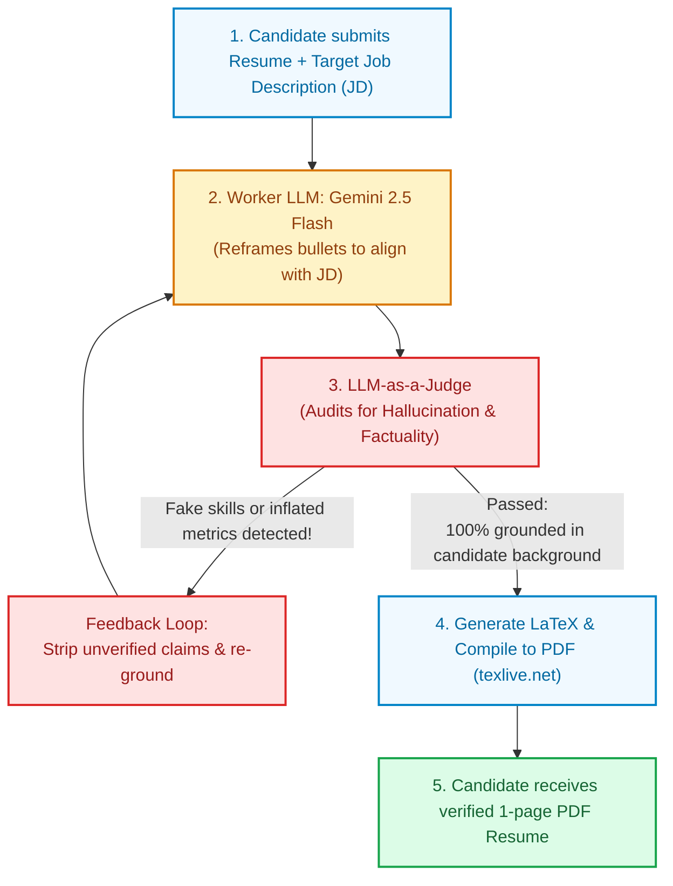
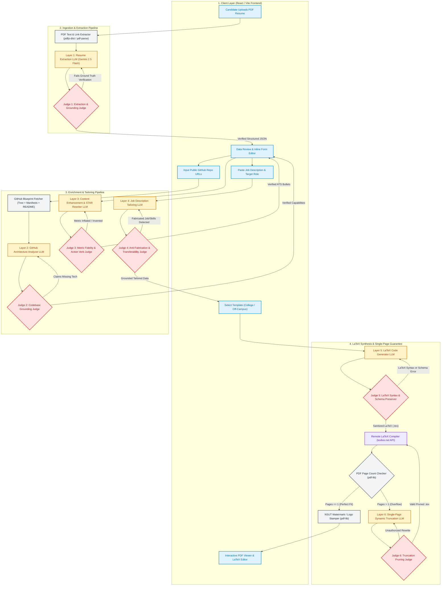

# Resume Builder: Flow Diagrams & LLM-as-a-Judge Architecture

This document provides both a **Simple Single-Flow Diagram** for quick understanding and the **Complete Multi-Stage Architecture** with dedicated **LLM-as-a-Judge** verification loops for every AI touchpoint.

---

## 1. Simple Flow: Resume Tailoring with LLM-as-a-Judge

This diagram illustrates the core job-tailoring pipeline, highlighting how an **LLM-as-a-Judge** layer prevents hallucinations, fake skill claims, and metric inflation before generating the resume.



### Simple Flow Step-by-Step Breakdown:
1. **Input:** The candidate provides their current resume and target Job Description (JD).
2. **Worker LLM ([geminiService.js](file:///c:/Users/Yashmit/Downloads/resume-builder/backend/services/geminiService.js#L269)):** Analyzes the JD and reframes the candidate's existing experience to highlight relevant responsibilities and keywords.
3. **LLM-as-a-Judge (Safety Guardrail):** Audits the output against the candidate's original background:
   - *Did the model invent tools or frameworks the candidate never used?*
   - *Were any numbers or metrics inflated (e.g. changing 10% to 80%)?*
   - *Are all statements believable and defensible in an interview?*
4. **Correction Loop:** If any unearned claim is detected, the judge sends specific feedback to the worker LLM to strip the fabrication.
5. **Compilation & Output:** Once approved, the resume is compiled into a pixel-perfect, 1-page PDF.

---

## 2. Full End-to-End System Flow



---

## 3. Sequence Diagram: Multi-Layer Judge Inspection

```mermaid
sequenceDiagram
    autonumber
    actor User as Candidate / User
    participant Frontend as Frontend UI
    participant Backend as Backend Controller
    participant LLM as Generative LLM (Worker)
    participant Judge as LLM-as-a-Judge (Auditor)
    participant Ext as TeXLive / PDF-Lib

    %% --- LAYER 1: EXTRACTION ---
    rect rgb(240, 249, 255)
    note over User, Judge: LAYER 1: Raw Resume PDF Extraction
    User->>Frontend: Upload Resume PDF
    Frontend->>Backend: POST /api/parse-resume (Multipart PDF)
    Backend->>Backend: Extract Raw Text & Hyperlinks (pdfjs-dist)
    Backend->>LLM: Prompt: Extract Structured Resume JSON
    LLM-->>Judge: Proposed Resume JSON
    Judge->>Judge: Audit: Cross-check against raw text & URLs
    alt Hallucination / Mismapped Links / Dropped History
        Judge-->>LLM: Rejection + Feedback: "URL mapped to wrong project; CGPA altered"
        LLM-->>Judge: Corrected Resume JSON
    end
    Judge-->>Backend: Approved Candidate JSON
    Backend-->>Frontend: Structured Profile in State
    end

    %% --- LAYER 2: GITHUB CODEBASE BLUEPRINT ---
    rect rgb(254, 243, 199)
    note over User, Judge: LAYER 2: Public GitHub Architecture Analysis
    User->>Frontend: Paste GitHub Repo URL
    Frontend->>Backend: POST /api/analyze-github
    Backend->>Backend: Fetch File Tree + Manifests (package.json, Dockerfile)
    Backend->>LLM: Prompt: Synthesize Architecture & Built Features
    LLM-->>Judge: Proposed Tech Stack & Feature Bullets
    Judge->>Judge: Audit: Verify claimed tech in package.json and file paths
    alt Phantom Technology / Exaggeration
        Judge-->>LLM: Rejection: "Redis not in package.json; remove caching claim"
        LLM-->>Judge: Grounded Feature Bullets
    end
    Judge-->>Backend: Verified Architecture Blueprint
    Backend-->>Frontend: Verified Project Capabilities Added
    end

    %% --- LAYER 3: BULLET ENHANCEMENT ---
    rect rgb(243, 244, 246)
    note over User, Judge: LAYER 3: STAR Bullet Enhancement
    User->>Frontend: Click "Enhance with AI" on Experience / Projects
    Frontend->>Backend: POST /api/enhance (Section Data)
    Backend->>LLM: Prompt: Rewrite with strong action verbs & impact
    LLM-->>Judge: Enhanced Section JSON
    Judge->>Judge: Metric Check: Original vs Enhanced Metrics
    alt Metric Inflation Detected (e.g. 10% became 75%)
        Judge-->>LLM: Rejection: "Fidelity violation: retain exact user metrics"
        LLM-->>Judge: Metric-Faithful ATS Bullets
    end
    Judge-->>Backend: Approved Enhanced JSON
    Backend-->>Frontend: Updated Resume Form
    end

    %% --- LAYER 4: JOB DESCRIPTION TAILORING ---
    rect rgb(254, 226, 226)
    note over User, Judge: LAYER 4: Job Description Tailoring
    User->>Frontend: Submit Target Job Description + Role
    Frontend->>Backend: POST /api/tailor-resume
    Backend->>LLM: Prompt: Reframe & Align with JD (No Fabrication)
    LLM-->>Judge: Tailored Resume Data + Adaptations Summary
    Judge->>Judge: Hallucination Check: Compare against Original Resume + GitHub
    alt Fabricated Credentials / Phantom Experience
        Judge-->>LLM: Rejection: "Candidate never worked with Kubernetes; revert claim"
        LLM-->>Judge: Grounded Tailored Resume JSON
    end
    Judge-->>Backend: Approved Tailored Profile
    Backend-->>Frontend: Tailored Resume + Adaptations Summary
    end

    %% --- LAYER 5: LATEX GENERATION ---
    rect rgb(237, 233, 254)
    note over User, Judge: LAYER 5: LaTeX Code Generation
    Frontend->>Backend: POST /api/generate-latex (Template: College / Off-Campus)
    Backend->>LLM: Prompt: Populate LaTeX Template with Resume JSON
    LLM-->>Judge: Proposed LaTeX Code (.tex)
    Judge->>Judge: Linting: Escape check (%, _, &), empty itemize check, placeholder purge
    alt Syntax Defects / Unescaped Characters
        Judge-->>LLM: Rejection: "Unescaped underscore on line 42; empty itemize found"
        LLM-->>Judge: Cleaned, compilable LaTeX Code
    end
    Judge-->>Backend: Approved .tex Document
    end

    %% --- LAYER 6: SINGLE PAGE TRUNCATION LOOP ---
    rect rgb(220, 252, 231)
    note over Backend, Ext: LAYER 6: Single-Page Guarantee & Dynamic Truncation
    Backend->>Ext: POST https://texlive.net/cgi-bin/latexcgi (Compile .tex)
    Ext-->>Backend: Compiled PDF Buffer
    Backend->>Ext: Check Page Count via pdf-lib
    alt Page Count > 1 (Overflow)
        loop Max 4 Truncation Iterations
            Backend->>LLM: Prompt: Prune least significant bullet points
            LLM-->>Judge: Truncated LaTeX Code
            Judge->>Judge: Diff Check: Verify ONLY minor bullets removed; structure intact
            Judge-->>Backend: Approved Truncated .tex
            Backend->>Ext: Recompile PDF & Check Page Count
        end
    end
    Backend->>Ext: Stamp NSUT Logo (if College template)
    Backend-->>Frontend: Final Base64 PDF + LaTeX Source
    Frontend-->>User: Display Single-Page PDF & Enable Export
    end
```

---

## 4. LLM-as-a-Judge Verification Rubric Matrix

| LLM Layer | Worker Task | Primary Hallucination Risks | Judge Verification Rubric & Invariant Checks | Remediation Strategy |
| :--- | :--- | :--- | :--- | :--- |
| **Layer 1: Resume Extraction** | Parses messy PDF text and hyperlinks into structured JSON. | Inventing dates/grades, hallucinating degrees, mapping GitHub URLs to wrong projects. | **Ground-Truth Anchor:** 100% of names, institutions, dates, and bullet text must exist as substrings or verbatim semantics in the raw PDF text. Link domains must match correct targets. | Send extraction diff back to LLM with the raw text excerpt to enforce fidelity. |
| **Layer 2: GitHub Analyzer** | Reads repo file tree, package manifests, and README to identify architecture. | Claiming popular frameworks (e.g. Redis, Docker) that do not exist in `package.json` or tree. | **Manifest Invariant:** Every claimed tool or library must be present in the repository dependency manifest or file paths. | Strip ungrounded technologies; retain only verifiable code patterns. |
| **Layer 3: Content Enhancement** | Converts passive bullets to active STAR format with metrics. | Metric inflation (e.g. changing "improved speed" to "increased speed by 90%"). | **Numerical Invariant:** No new numbers or percentages may be generated unless explicitly provided by the candidate. | Enforce verbatim retention of all existing metrics while upgrading verbs. |
| **Layer 4: Job Tailoring** | Aligns candidate background with JD terminology without lying. | Fabricating whole skills or jobs just to match ATS keywords. | **Anti-Fabrication Invariant:** Skills and experiences must be a strict subset or legitimate reframing of Original Data + Verified GitHub Context. | Calculate Hallucination Score; if > 0, reject additions and fall back to semantic reframing. |
| **Layer 5: LaTeX Generation** | Populates template placeholders with JSON data into valid `.tex`. | Unescaped TeX special characters (`_`, `%`, `&`), unclosed environments, dropped sections. | **Grammar & Completeness Invariant:** Preamble must match template; all special characters escaped in display text; zero empty `\item` blocks. | Auto-patch common escape slips and re-prompt if structural blocks are broken. |
| **Layer 6: Page Truncation** | Selectively trims bullets to force PDF onto 1 page. | Accidental deletion of entire primary projects, broken LaTeX tags (`\end{itemize}`). | **Pruning Constraint:** Structural tags must match 1-to-1 with input; maximum 1-2 bullets removed per iteration; high-priority sections protected. | Verify AST tag balance before submitting to remote compiler. |
