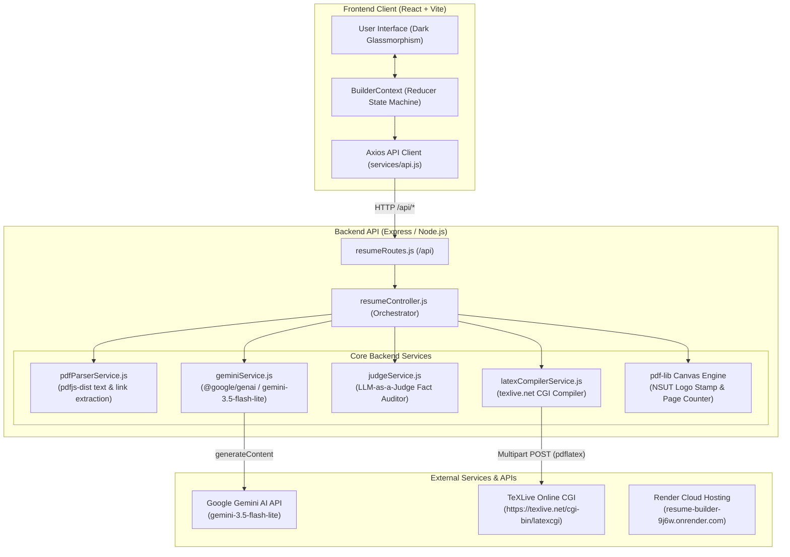
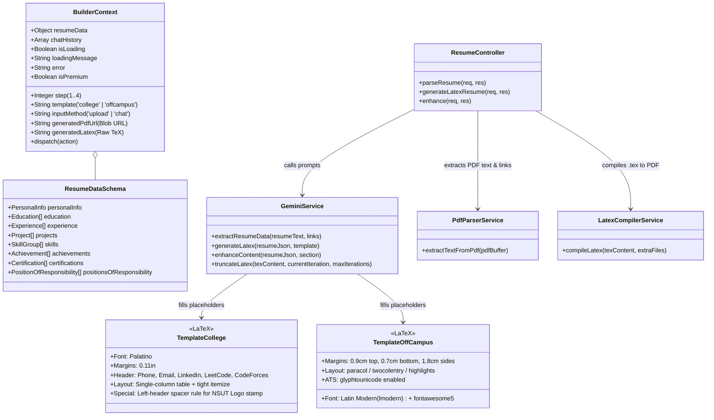
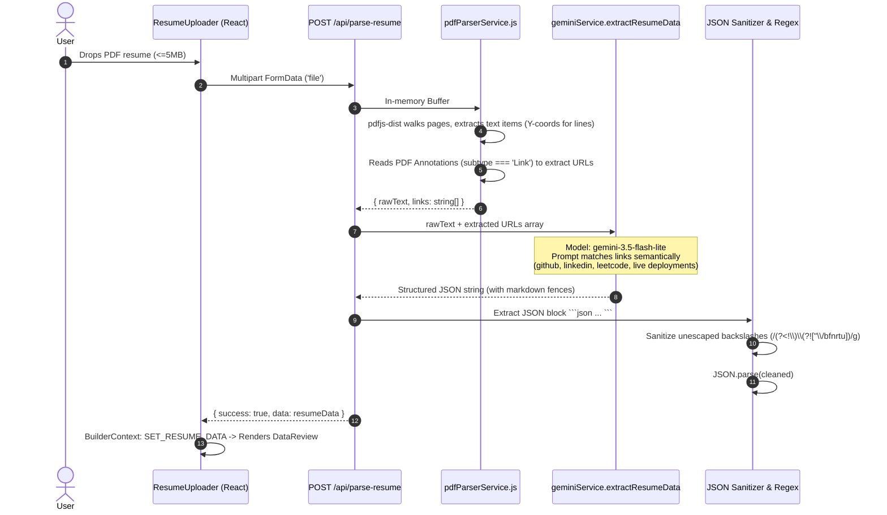
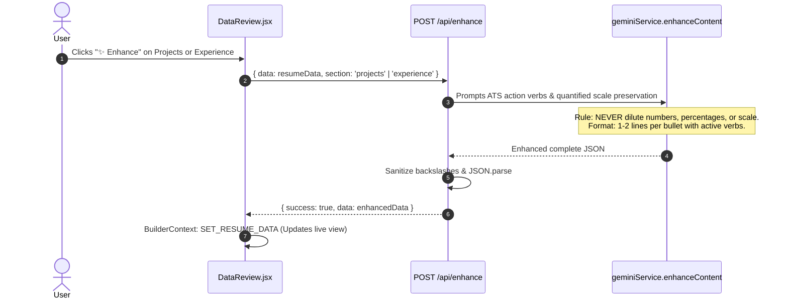
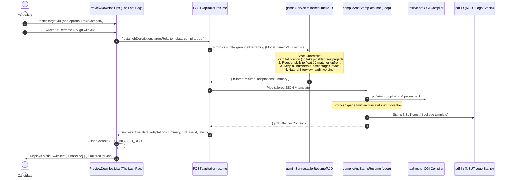
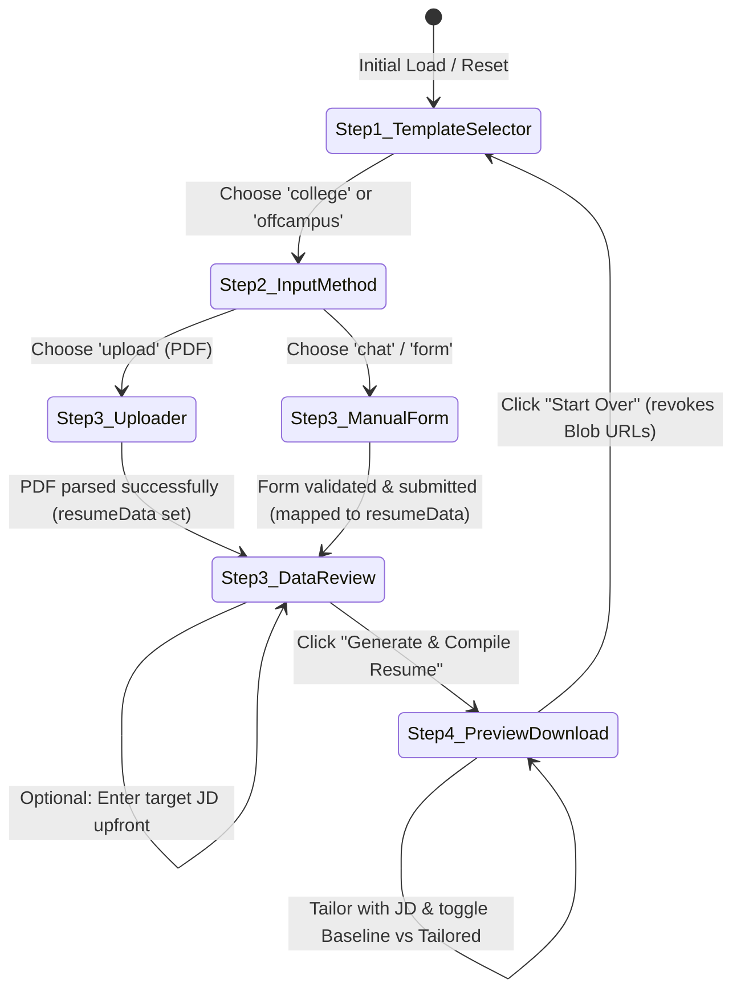

# Resume Builder (NSUT) — System Knowledge Graph & Agent Context

> **Target Audience:** AI Coding Agents & Engineers  
> **Repository:** `resume-builder`  
> **Stack:** React 18 (Vite SPA) + Node.js / Express (CommonJS) + LaTeX Compiler (`texlive.net`) + Google Gemini AI (`@google/genai`) + `pdf-lib`  
> **Last Updated:** 2026-09-22

---

## 1. High-Level System Architecture & Topology

The application is an end-to-end resume builder that transforms candidate credentials (via PDF upload or manual multi-tab forms) into an ATS-optimized, pixel-perfect PDF compiled from LaTeX source code.



---

## 2. Complete Knowledge Entity Graph



---

## 3. End-to-End Data Pipelines & Workflows

### 3.1. Parsing Pipeline (`/api/parse-resume`)



---

### 3.2. Generation, Compilation & Iterative Truncation Loop (`/api/generate-latex`)

This is the most critical pipeline in the application. It guarantees **single-page compliance** using a self-correcting feedback loop.

```mermaid
flowchart TD
    Start([Client calls POST /api/generate-latex]) --> LoadTemplate[Load templates/college.tex or offcampus.tex]
    LoadTemplate --> CallGemini[Call geminiService.generateLatex]
    CallGemini --> CleanLatex[Post-Process LaTeX: Remove empty sections without breaking preamble]
    
    CleanLatex --> InitLoop[Set iteration = 1, maxIterations = 4]
    InitLoop --> Compile[latexCompilerService: POST to texlive.net CGI]
    
    Compile -- Compilation Error --> Fail[Write last_failed.tex & last_failed.log -> Return HTTP 500]
    Compile -- Success --> CheckPages[pdf-lib: PDFDocument.load(buffer) -> getPageCount()]
    
    CheckPages -- pageCount === 1 --> CheckTemplate{template === 'college'?}
    CheckPages -- pageCount > 1 --> CheckIter{iteration < maxIterations?}
    
    CheckIter -- Yes --> TruncateAI[Call geminiService.truncateLatex\nIter 1-2: Remove 1-2 bullet points\nIter 3: Ruthlessly cut 3-4 bullets / lowest project]
    TruncateAI --> Incr[iteration++]
    Incr --> Compile
    
    CheckIter -- No (Max Reached) --> CheckTemplate
    
    CheckTemplate -- Yes --> StampLogo[pdf-lib: Embed assets/NSUT_logo.png\nat top-left header coordinates\nx=marginPts, y=height - marginPts - imgHeightPts]
    CheckTemplate -- No --> ReturnResult[Convert final buffer to Base64]
    StampLogo --> ReturnResult
    
    ReturnResult --> SendResponse[Return { success: true, pdfBase64, latex }]
    SendResponse --> ClientPreview[Frontend: Convert Base64 to Blob URL -> display in iframe]
```

---

### 3.3. Section Content Enhancement Pipeline (`/api/enhance`)



---

### 3.4. Job Description (JD) Tailoring Pipeline (`/api/tailor-resume`)

This pipeline allows candidates to tailor their resume to a specific job opening without fabricating false achievements or drastically distorting their true background.



---

## 4. Frontend Component & State Architecture

### 4.1. Step Navigation State Machine



### 4.2. File & Component Directory Breakdown

| File Path | Role | Key Behaviors & Gotchas |
|:---|:---|:---|
| `frontend/src/App.jsx` | Root Flow Orchestrator | Renders `LandingPage` or `BuilderFlow`. Handles header with step indicator and global Back button. Back button in Step 3 clears `resumeData` to return to uploader/form. |
| `frontend/src/context/BuilderContext.jsx` | Global State Store | `useReducer` managing `step`, `template`, `inputMethod`, `resumeData`, `generatedPdfUrl`, `generatedLatex`, `jobDescription`, `targetRole`, `tailoredData`, `tailoredPdfUrl`, `tailoredLatex`, `adaptationsSummary`, `activeViewMode` ('original' \| 'tailored'), `isLoading`, `error`. |
| `frontend/src/services/api.js` | Backend API Gateway | Configured with `API_BASE_URL`. Endpoints: `parseResumeApi`, `generateLatexApi`, `enhanceApi`, `tailorResumeApi`. |
| `frontend/src/components/LandingPage.jsx` | Marketing & Hero Page | Introduces ATS features, templates, LaTeX compilation guarantee. |
| `frontend/src/components/StepIndicator.jsx` | Multi-step progress bar | Visual indicator for steps 1 to 4. |
| `frontend/src/components/TemplateSelector.jsx` | Step 1 Selector | Options: `college` (NSUT academic format) vs `offcampus` (industry corporate format). |
| `frontend/src/components/InputMethodSelector.jsx` | Step 2 Selector | Options: `upload` (PDF upload) vs `chat` (manual structured form). |
| `frontend/src/components/ResumeUploader.jsx` | Step 3 Upload UI | Drag-and-drop zone. Enforces `application/pdf`. Calls `parseResumeApi(file)`. |
| `frontend/src/components/ManualForm.jsx` | Step 3 Manual Form | Multi-tab form (`personal`, `education`, `experience`, `projects`, `skills`). Persists draft state in `sessionStorage("resumeFormData")`. Maps local schema to canonical `resumeData` on submit. |
| `frontend/src/components/DataReview.jsx` | Step 3 Data Review | Grid layout preview of candidate data before compilation. Includes discovery card & optional accordion to provide target JD early. Triggers `generateLatexApi` (and `tailorResumeApi` if JD supplied). |
| `frontend/src/components/PreviewDownload.jsx` | Step 4 Output & JD Studio | The primary interactive hub on the last page. Features: Live PDF preview iframe, segmented mode toggle (`[📄 Baseline]` vs `[🎯 Tailored for Job]`), adaptation summary banner, full JD Tailoring Studio form, dynamic download/copy actions matching the active toggle mode, and Start Over. |
| `frontend/src/index.css` | Design System | Pure Vanilla CSS with CSS Custom Properties. Dark theme (`#0a0a0f`), glassmorphism cards, responsive layouts, mode toggle switcher styles, pulse badges. No Tailwind dependency. |

---

## 5. Backend Services & Infrastructure Architecture

| File Path | Role | Key Implementation Specifics |
|:---|:---|:---|
| `backend/app.js` | Express Server Entry | Express 4, `cors()`, `express.json({ limit: "10mb" })`, `express.urlencoded({ limit: "10mb" })`. Route prefix: `/api`. Global error handler. Port default: `5000`. |
| `backend/routes/resumeRoutes.js` | Express Router | Multer memory storage (`5MB` limit). Routes: `POST /parse-resume`, `POST /generate-latex`, `POST /enhance`, `POST /tailor-resume`, `POST /analyze-github`. |
| `backend/controllers/resumeController.js` | Business Logic Controller | Coordinates parsing, sanitizing LLM output, shared `compileAndStampResume` loop with single-page guarantee and NSUT logo stamp, `tailorResume`, and `analyzeGithub` handler. |
| `backend/services/geminiService.js` | Google GenAI SDK Interface | Uses `@google/genai` (v0.1+ syntax). Model: `gemini-3.5-flash-lite`. Handlers: `extractResumeData`, `generateLatex`, `enhanceContent`, `truncateLatex`, `tailorResumeToJD` with verified codebase context. |
| `backend/services/githubService.js` | GitHub Codebase Inspector | Fetches recursive git trees, manifests (`package.json`, `requirements.txt`), and analyzes real architecture using Gemini without requiring auth tokens for public repositories. |
| `backend/services/pdfParserService.js` | PDF Extraction Engine | Uses dynamic import of `pdfjs-dist/legacy/build/pdf.mjs` for Node.js compatibility. Reconstructs text lines using vertical coordinate tracking (`yMin`). Extracts embedded hyperlink annotations. |
| `backend/services/latexCompilerService.js` | Remote LaTeX Compiler | Sends multipart form data (`filecontents[]`, `filename[]`, `engine=pdflatex`, `return=pdf`) to `https://texlive.net/cgi-bin/latexcgi`. Timeout: 60s. On failure, dumps `last_failed.tex` and `last_failed.log` to disk. |
| `backend/templates/college.tex` | NSUT College Template | Single-column, Palatino font, 0.11in margins, grey bar headings (`\colorbox{mygrey}`). Top-left space reserved for stamped logo. Course + University line width constrained. |
| `backend/templates/offcampus.tex` | Off-Campus Template | Professional industry template based on RenderCV. Packages: `titlesec`, `tabularx`, `paracol`, `fontawesome5`, `lastpage`, `needspace`. Uses custom environments (`highlights`, `onecolentry`, `twocolentry`). |
| `backend/assets/NSUT_logo.png` | College Crest Graphic | Stamped onto page 1 of compiled PDF by `pdf-lib` at run time (because remote LaTeX compilers cannot access local assets). |

---

## 6. Canonical Data Schema (`resumeData`)

Every subsystem (PDF extractor, manual form, reviewer, enhancer, and LaTeX generator) conforms to this standard JSON contract:

```json
{
  "personalInfo": {
    "fullName": "string",
    "email": "string",
    "phone": "string",
    "linkedin": "string (optional)",
    "github": "string (optional)",
    "portfolio": "string (optional)",
    "leetcode": "string (optional)",
    "codeforces": "string (optional)",
    "location": "string (optional)"
  },
  "education": [
    {
      "institution": "string",
      "degree": "string",
      "field": "string",
      "cgpa": "string (optional)",
      "startDate": "string",
      "endDate": "string",
      "coursework": ["string"]
    }
  ],
  "experience": [
    {
      "company": "string",
      "role": "string",
      "startDate": "string",
      "endDate": "string",
      "bullets": ["string"],
      "location": "string (optional)"
    }
  ],
  "projects": [
    {
      "name": "string",
      "description": "string (optional)",
      "techStack": ["string"],
      "bullets": ["string"],
      "link": "string (optional, GitHub/Source code)",
      "liveLink": "string (optional, live URL)"
    }
  ],
  "skills": [
    {
      "category": "string (e.g. Languages, Frameworks, Tools)",
      "items": "string (comma-separated list)"
    }
  ],
  "achievements": [
    {
      "title": "string",
      "description": "string (optional)",
      "date": "string (optional)"
    }
  ],
  "certifications": [
    {
      "name": "string",
      "issuer": "string (optional)",
      "date": "string (optional)"
    }
  ],
  "positionsOfResponsibility": [
    {
      "role": "string",
      "organization": "string",
      "bullets": ["string"],
      "startDate": "string (optional)",
      "endDate": "string (optional)"
    }
  ]
}
```

---

## 7. Critical Quirks, Bugs & Architectural Gotchas (For Coding Agents)

### ⚠️ 1. LaTeX Math Mode Underscore Crash (`Missing $ inserted`)
- **Symptom:** Remote compilation fails with `! Missing $ inserted.` around the contact header.
- **Cause:** In LaTeX, an unescaped underscore `_` initiates math subscript mode. If a candidate’s email is `john_doe@nsut.ac.in` or GitHub is `github.com/john_doe`, pdflatex crashes unless escaped.
- **The Fix:** Display text MUST be escaped as `\_`, but the parameter inside `\href{...}` must NOT be escaped.
  - Correct: `\href{mailto:john_doe@test.com}{john\_doe@test.com}`
  - Incorrect: `\href{mailto:john\_doe@test.com}{john_doe@test.com}`
- **Enforcement:** Enforced in `geminiService.js` prompt rule #5.

### ⚠️ 2. Preambles Corrupted by Empty Section Stripping Regex
- **Symptom:** `offcampus.tex` compilation fails with `\begin{document} ended by \end{highlights}`.
- **Cause:** To prevent LaTeX `empty itemize` errors when a candidate has no experience/certifications, an automated regex prunes empty `\begin{itemize}` blocks. However, `offcampus.tex` defines `\newenvironment{highlights}{\begin{itemize}...}{\end{itemize}}` in its preamble. An indiscriminate regex matched and deleted the preamble definition!
- **The Fix:** In `resumeController.js` (lines 165-179), the replacement regex is strictly applied **only to the document body** (`latexCode.substring(docStart)`), preserving the preamble intact.

### ⚠️ 3. Remote Compiler Graphic Inclusion (NSUT Logo)
- **Symptom:** `\includegraphics{NSUT_logo.png}` fails because `texlive.net` runs in an isolated container without the project’s local asset directory.
- **The Architecture Solution:**
  1. `college.tex` uses a phantom rule `\rule{0pt}{0.7in}` in a 0.12\textwidth minipage to leave an exact blank bounding box in the top-left header.
  2. After `texlive.net` compiles the TeX to PDF, `resumeController.js` intercepts the PDF buffer.
  3. `pdf-lib` loads the PDF, reads `assets/NSUT_logo.png`, and draws the image onto Page 1 at coordinate `(x: marginPts, y: height - marginPts - imgHeightPts)`.

### ⚠️ 4. JSON Backslash Escaping from Gemini LLM
- **Symptom:** `JSON.parse` fails with `SyntaxError: Bad escaped character in JSON at position...`.
- **Cause:** When Gemini produces resume text containing LaTeX commands (e.g. `\href`, `\textbf`, `\item`), it often outputs single backslashes rather than double-escaped `\\`.
- **The Fix:** In `resumeController.js` (parseResume & enhance), before calling `JSON.parse`, unescaped backslashes are sanitized:
  ```javascript
  cleaned = cleaned.replace(/(?<!\\)\\(?!["\\/bfnrtu])/g, "\\\\");
  ```

### ⚠️ 5. Strict Single-Page Requirement & AI Truncation
- College campus placement policies at NSUT strictly mandate a **single-page resume**.
- If candidate data is too long, the PDF produces 2 pages.
- The backend runs a `while (!isSinglePage && iterations < MAX_ITERATIONS)` loop:
  - Iterations 1-2: Gemini removes the 1-2 least significant bullet points.
  - Iteration 3: Gemini is instructed to ruthlessly cut 3-4 bullets and eliminate minor experiences/projects.
  - If still overflowing after 4 iterations, it logs a warning and proceeds rather than throwing an unhandled exception.

### ⚠️ 6. Remote API Base URL in Frontend
- `frontend/src/services/api.js` currently defaults to:
  ```javascript
  const API_BASE_URL = 'https://resume-builder-9j6w.onrender.com/api';
  ```
- If debugging backend changes locally, remember that the frontend calls the deployed Render backend unless updated to `http://localhost:5000/api` or configured via `import.meta.env.VITE_API_URL`.

---

## 8. Environment Variables & Run Commands

### 8.1. Backend (`backend/.env`)

```ini
PORT=5000
GOOGLE_API_KEY=your_gemini_api_key_here
OPENAI_API_KEY=optional_fallback_key
```

### 8.2. Local Execution Commands

```bash
# Terminal 1: Backend
cd backend
npm install
npm run dev     # Runs: node --watch app.js (Node 18+)

# Terminal 2: Frontend
cd frontend
npm install
npm run dev     # Runs Vite dev server at http://localhost:5173
```

---

## 9. Quick File Reference Map

```text
resume-builder/
├── KNOWLEDGE_GRAPH.md              # <-- This master reference document
├── README.md                       # High-level overview
├── AGENTS.md                       # Agent instructions & boundary rules
├── backend/
│   ├── .env                        # Local environment secrets
│   ├── app.js                      # Express configuration & global error handling
│   ├── package.json                # Express, @google/genai, pdf-lib, pdfjs-dist, multer
│   ├── assets/
│   │   └── NSUT_logo.png           # Stamped into Page 1 header for college template
│   ├── controllers/
│   │   └── resumeController.js     # Orchestrates parsing, generation loop & logo stamping
│   ├── routes/
│   │   └── resumeRoutes.js         # /parse-resume, /generate-latex, /enhance
│   ├── services/
│   │   ├── geminiService.js        # Gemini 3.5 Flash Lite prompt orchestration
│   │   ├── latexCompilerService.js # TexLive CGI HTTP compiler integration
│   │   └── pdfParserService.js     # pdfjs-dist text & hyperlink coordinate extractor
│   └── templates/
│       ├── college.tex             # NSUT placement template (Palatino, single-col, tight)
│       └── offcampus.tex           # RenderCV-style off-campus corporate template
└── frontend/
    ├── package.json                # React 18, Vite, Axios
    ├── vite.config.js              # Vite React configuration
    └── src/
        ├── App.jsx                 # Top-level flow & header navigation
        ├── index.css               # Design system & dark glassmorphic styles
        ├── components/
        │   ├── LandingPage.jsx     # Landing hero & feature cards
        │   ├── StepIndicator.jsx   # Steps 1 to 4 tracker
        │   ├── TemplateSelector.jsx# College vs Off-Campus selector
        │   ├── InputMethodSelector.jsx # PDF Upload vs Manual Form selector
        │   ├── ResumeUploader.jsx  # Drag-and-drop PDF parser trigger
        │   ├── ManualForm.jsx      # Multi-tab structured form with sessionStorage
        │   ├── DataReview.jsx      # Review grid & Gemini bullet point enhancer
        │   └── PreviewDownload.jsx # PDF iframe, .pdf/.tex downloader, copy TeX
        ├── context/
        │   └── BuilderContext.jsx  # Reducer state machine for step & resume data
        └── services/
            └── api.js              # Axios HTTP calls to backend
```
